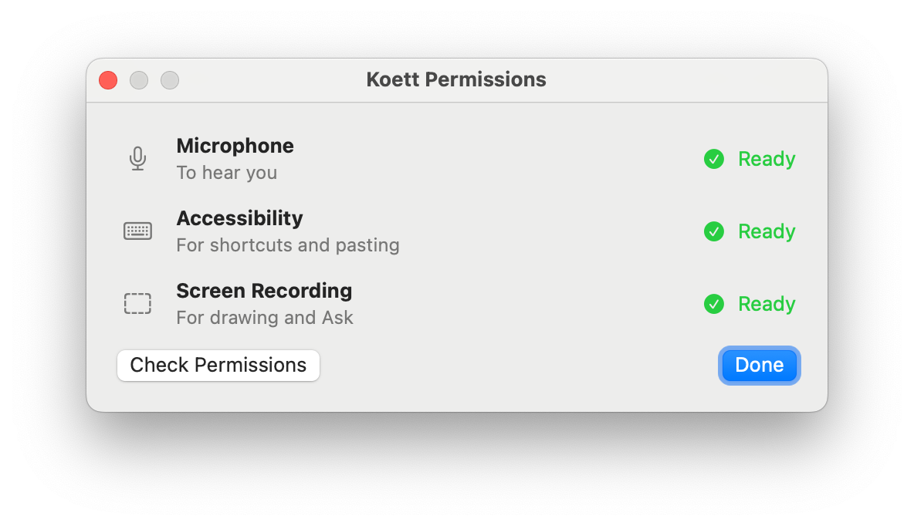

# Mac permission capability checks

> Historical evidence and commands use the [0.3.1 source snapshot](https://github.com/oEdyb/koett/tree/c1e9d812d68fb0c8f035d0041a6d1da29f96c041). See [the evidence archive](evidence-archive.md) for private reproduction.

The Permissions window's explicit **Check Permissions** action verifies granted
access through the actual APIs. Normal startup and dictation do not require this
extra step. No new permission type is requested.

- Microphone: open the selected input through Koett's normal HAL capture and wait
  up to one second for a nonempty audio buffer. Silence is valid. Discard every
  buffer; stop the input on success, timeout, cancellation or start failure.
- Accessibility: verify post-event access and create/invalidate an active session
  event tap. Do not post input or add an Input Monitoring request.
- Screen Recording: acquire a single 16×16 ScreenCaptureKit still, without audio,
  then discard it. A list of displays alone is not treated as capture proof.

The existing grant is shown as **Allowed**; a successful explicit check becomes
**Ready**. A failed check shows **Check failed** and **Retry**. Screen capture also
offers Relaunch. Checks skip denied permissions and recheck the grant after the
API returns, so revocation cannot leave a green result. Readiness is in memory;
each app launch starts unverified. The window's background timer only refreshes
system grant flags, and never captures.

macOS can show its existing screen-capture bypass consent when a granted app
actually captures. This may happen after clicking Check Permissions, as it can
when drawing or using Ask. The check never saves audio or a screenshot, changes
system input devices or types into another app.

## Limits

A microphone buffer proves input delivery, not acoustic accuracy. Creating an
event tap and checking post access does not prove a physical shortcut or target
editor consumed paste. One still does not certify every display or future access;
actual dictation/drawing still handles runtime errors and recovery.

## Verification

Unit tests inject grant/probe results to cover denied-access skipping, failure
under an allowed flag, retry, and revocation during a probe. Fake capture tests
require a real buffer callback and verify input cleanup after timeout/start
failure. The isolated-home full suite passes 449 tests (16 skipped), with zero failures;
release build and static packaging gates pass. A private signed `fab92a6` build
on macOS 15.7.7 reports Ready for all three checks through the actual APIs. After
checking, actual BlackHole capture/Stop/native paste still succeeds: target
receipt arrives after Stop and ends with the latest generated transcript. This
also verifies that the microphone check releases its capture resources.

Failure/retry and grant-revocation races are injected unit checks, not fresh OS
refusal dialogs. No host permissions or installed app changed. These results do
not certify a final release ZIP or physical shortcut dispatch.

API references: [Apple screenshot API](https://developer.apple.com/documentation/ScreenCaptureKit/SCScreenshotManager/captureImage(contentFilter:configuration:completionHandler:)),
[Apple event taps](https://developer.apple.com/documentation/coregraphics/cgevent/tapcreate(tap:place:options:eventsofinterest:callback:userinfo:)).
