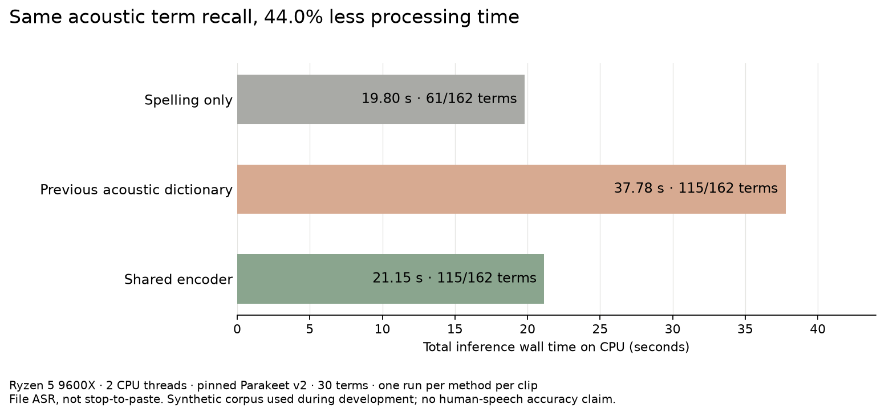

# Workflow performance audit — November 2026

**Verdict: slower than the v0.1.1 fallback in the native M5 controlled-input workflow: +6.36%, +15.59%, +25.14% and +20.92% median Stop-to-target time at 5/30/120/600 s.** The filmed executable is not known. The dictionary doubling is fixed on Linux and disabled by default on Mac; these fixes do not justify a new “faster than the video” claim.

This audits the proposed v0.3.0 build; no v0.3.0 tag or public release is implied.
The comparison uses measured endpoints, not vendor speed claims. First-install,
permissions and distribution gates remain in the separate release audit.

## Video baseline

The archived recording card for *Can a Free Local App Replace Wispr Flow?*
records a scheduled publication of **2026-08-18 at 18:30 CEST** and the selected
thumbnail **“4× FASTER”**. [Video](https://youtu.be/0xVRE7eX8Ns).
Its saved published description says:

> In my controlled five-run test on my M5 Mac, Koett’s median release-to-paste time was 118.5 ms. Wispr Flow’s was 481 ms, so Koett was about 4.1× faster in this test. Both got every word right.

The repository's [historical receipt](verification-receipts.md) qualifies the
endpoints: Koett **paste-post**, Wispr **finished processing**. Neither is a
receipt proving target insertion. Do not renew the 4.1× comparison from these
unequal endpoints, or compare 118.5 ms directly with a new target-receipt timer.

The exact filmed executable was not recovered. The permitted fallback is
**v0.1.1, `c72f83415b1d760c30316f07fc776f09b0ebdc0b`**. Its recorded git date is
after the video's scheduled publication, so it is a fallback rather than a
proven identification of the filmed binary. v0.1.1 has no Linux implementation.
The same-machine old/current release comparison therefore belongs to the Mac.

## What the timers mean

| Endpoint | Meaning | Limits |
|---|---|---|
| Capture ready | Audio stream has started and collector exists | Linux software command/key issuance includes launch and polling overhead; not USB latency |
| File ASR | Inference plus the explicitly stated correction step | Excludes recording, delivery, storage and UI |
| Stop to target text | Actual text appended to the private target, after normal app processing and paste | Target is a controlled receiver, not every editor |
| Image to text | Target has decoded/appended PNG, then appended text | Distinct from clipboard offer or paste-post |
| Ten-minute Linux Stop | The app's automatic 600 s stop request, timestamped in the runtime | The hard recording limit prevents a manual stop after full 600 s playback |

Linux transcribes segments while recording. Ten minutes of file ASR taking
seconds does not mean the live app waits that long after Stop. The live timers
include finalization and real delivery; file-ASR numbers are kept separate.

## Mac: v0.1.1 fallback versus current

**Slower in the measured native M5 controlled-input pipeline.** The exact filmed executable is unknown; this compares the explicitly permitted public v0.1.1 fallback. Three repeats per build and length, six alternating build groups, identical SHA-verified PCM per length, raw formatting, empty dictionary, same pinned FluidAudio 0.15.6. Current measured source `85dde51`; final default/test/report source `3998053`.

| Audio | v0.1.1 median / worst ms | Current median / worst ms | Median change |
|---|---:|---:|---:|
| 5 s | 148.34 / 182.76 | 157.78 / 216.73 | +6.36% |
| 30 s | 258.61 / 260.98 | 298.92 / 368.48 | +15.59% |
| 120 s | 521.81 / 534.28 | 652.97 / 710.88 | +25.14% |
| 600 s | 2,134.91 / 2,150.45 | 2,581.46 / 2,720.39 | +20.92% |

At 30–600 s every current observation exceeded every old observation. Five-second ranges overlap. These timers begin before the real Stop method and end after a foreign `NSTextView.super.paste` consumes the result. The harness substitutes controlled PCM before recorder writes, then retains real Stop/close, transcription, preparation, paste-readiness checks, clipboard and Command-V. It is not a sum of component times or a file-ASR substitute.

This excludes acoustic microphone acquisition, physical-key dispatch and compositor pixels. Old capture uses an AudioQueue processing tap at 16 kHz; current input is 48 kHz and writes a 16 kHz file. The old-only tap teardown is inside Stop and can bias small differences against old. Private hardened source apps lack an audio-input entitlement; pre-substitution input can be silent. Current forces built-in input; a read-only query confirmed the system default was built-in too. Modifiers were normalized up before timing; the 1.5-second held-key wait branch was not exercised. Fixed length order, three repetitions, and absent thermal/power telemetry limit generalization.

Root independently recomputed all 24 receipt durations and cell medians, checked unique requests and ordered source generations 2–5, same fixture hash per length, matching source PIDs, exactly one clipboard generation advance, exact receiver/clipboard equality, restoration, injected-frame lower bounds, final normalized phrase anchors, at least 97% reference-completed length and at most 1% cross-build/repeat length variation. These guards establish fresh and sufficiently complete synthetic payloads; they do not certify human-speech accuracy.

Same-invocation production stages localize the regression to Stop/frontend processing rather than spelling or delivery. The stage medians below are descriptive; their sums are not used as the end-to-end endpoint.

| Audio | Stop → ASR start old / current ms | ASR/frontend old / current ms | Current text preparation ms |
|---|---:|---:|---:|
| 5 s | 44.6 / 71.5 | 98.6 / 76.6 | 0.0 |
| 30 s | 47.4 / 85.3 | 199.9 / 210.2 | 0.1 |
| 120 s | 49.4 / 85.4 | 463.9 / 562.2 | 0.5 |
| 600 s | 47.9 / 83.9 | 2078.7 / 2482.0 | 2.5 |

Recompute the frozen comparison with `python3 Benchmarks/Performance/2026-11/check-mac.py` (fetch the Mac audit branch first if needed). Original [24 raw receipts](https://github.com/oEdyb/koett/blob/3998053ffe7c5ee451476fcffb03cd8742796193/Benchmarks/Dictionary/performance-20261105/native-paste.json), [stage receipts](https://github.com/oEdyb/koett/blob/3998053ffe7c5ee451476fcffb03cd8742796193/Benchmarks/Dictionary/performance-20261105/native-same-invocation-stages.json), [harness and exact source patches](https://github.com/oEdyb/koett/blob/3998053ffe7c5ee451476fcffb03cd8742796193/Benchmarks/Dictionary/PasteAudit/Host/), and [full Mac report](https://github.com/oEdyb/koett/blob/3998053ffe7c5ee451476fcffb03cd8742796193/docs/performance-audit-macos-2026-11.md) bind this result to the tested source. Eight single real-capture/BlackHole guest validations also passed, but VM Core ML timings are excluded from the native verdict.

Mac's separate acoustic encoder added 180.78%, 283.16%, 389.31% and 97.34% to median file-transcription time at the four lengths. At 600 s it hit the two-second deadline; inference continued another 5.99–6.97 s after the returned result and was discarded. Default acoustic boosting is disabled. Cheap correction recovers 61/162 synthetic term occurrences versus 117/162 with experimental acoustic boosting, losing 56 recovered occurrences. This is an explicit speed/recall tradeoff.

A fresh process that never loaded CTC repeated three alternating off/default pairs per length: default median changes +1.31%, −7.53%, −1.83%, +0.25%; all 12 default outputs matched the earlier cheap path. Negative changes are timing variation. The disabled callback plus spelling measured 0.613–1.433 ms in nine additional 120 s probes. This establishes cheap correction overhead, not acoustic equivalence or a per-recording ceiling.

The Mac passed 434 Swift tests with 12 optional skips, release build and required static/packaging checks. Independent review found no runtime/default blocker at `5ef3c30`; the final test/verifier/disclosure fixes passed local gates and were not reviewed again. Current native capture-ready/launch CPU/full-app memory/drawing measurements were not repeated on Mac; the equivalent fresh Linux measurements below and the Mac's historical receipts do not fill those platform-specific gaps.

## Linux isolation and source

Host: **Ryzen 5 9600X, 12 logical CPUs, approximately 60 GiB RAM, CachyOS x86_64**.
Inference uses two CPU threads and the pinned int8 Parakeet v2 model; no GPU.
The final app adds the dictionary fix to main `e812567` (including paste fix #104).
The repeated full workflow below first used `6e32bd2` (app
`ed149ec10ca15bf019df877c215d4cc00f71a470474113aa2267098134542a96`).
The model-reuse follow-up is `129c462`, app
`a7466efe361186ba5b78b080c185e3da3e838f332d62cb4c63445453d5a77ec6`.
Final-build repeats are separately identified; older measurements are not
relabeled as that binary.

One owned invisible KWin lab contains nested niri and an Electron 43 target.
The app is installed through its real installer into a private prefix, with
private HOME/settings and copied models. App and target have only loopback in
their network namespace. No installed app, user dictation, host focus, pointer
or clipboard is used. Audit exports contain counters, synthetic test IDs and
hashes, never private transcript-store text.

The niri native clipboard/virtual-keyboard path is measured. A filtered proxy
allows only the outer KDE screenshot service, keeping its RemoteDesktop and
Clipboard interfaces out of the nested session. Earlier mixed-portal timings
were **discarded**: the outer clipboard could differ from niri's and stale text
could satisfy a weak receiver check. Every final synthetic dictation now has a
unique literal-replacement marker; the target must receive that exact marker,
exactly one text event, and a hash matching the retained clipboard when checked.
This fixture marker does not change audio or acoustic decoding.

The final four-length live repeat ran without another owned ASR benchmark or build. Each case records observed host load. The client inherits a 4 GiB ancestor high watermark and 6 GiB maximum; the separate root agent budget can impose further limits. These are not unconstrained idle-host guarantees. Raw dictation is selected; optional S1-mini, Ask and media are off. No speech model or dependency pin changes.

Builds and standalone probes use `CARGO_BUILD_JOBS=4`, `nice -n 10` and a 12 GiB
scope; build/cache output is in the worktree or cache, never `/tmp`. The live
client scope is capped at 12 GiB; the app is launched at absolute nice 10. The
separate constrained-memory case changes only this owned scope and restores it.
CPU percentages use **100% for one logical CPU**, not the entire 12-CPU host.

## Linux full app: Stop to real target text

Final model-reuse app, three measured trials per length:

| Audio | Control to capture-ready median / worst ms | Stop to target median / worst ms | Recording CPU median / worst % |
|---|---|---|---|
| 5 s | 41.38 / 50.86 | 367.11 / 404.69 | 3.90 / 4.70 |
| 30 s | 41.29 / 52.12 | 179.42 / 221.23 | 11.22 / 11.26 |
| 120 s | 52.39 / 53.15 | 206.24 / 210.00 | 11.96 / 12.10 |
| 600 s | 50.64 / 53.08 | 280.75 / 288.70 | 12.33 / 12.36 |

Earlier shared candidate V1 under changing host/ancestor pressure (retained):

| Audio | Stop to target median / worst ms | Observed 1-minute load range |
|---|---|---|
| 5 s | 373.22 / 737.85 | 0.56–13.57 |
| 30 s | 204.25 / 250.10 | 0.63–8.87 |
| 120 s | 204.69 / 229.95 | 0.92–2.10 |
| 600 s | 273.17 / 18,521.47 | 0.66–14.67 |

The 5/30/120 s public WAVs play through the private PipeWire sink into real CPAL
capture. For ten minutes, the 600 s source continues until the app's hard limit;
the app's timestamp identifies the automatic Stop. Audio playback can lag wall
time under load, so this is a 600 s live capture, not proof that every source
frame played before cutoff. Exact 600 s audio is separately covered by file ASR.
No manual Stop time after an already completed automatic paste is accepted.

## Feature cost, startup and resources

| 5 s case | Stop to text median / worst ms | Drawing surfaces ready median / worst ms | Image to text median / worst ms | Recording CPU median / worst % |
|---|---|---|---|---|
| Drawing off | 367.11 / 404.69 | — | — | 3.90 / 4.70 |
| Drawing on, no ink | 356.69 / 393.31 | 143.35 / 168.15 | — | 4.15 / 4.32 |
| One drawing | 729.61 / 743.90 | 182.44 / 187.36 | 288.35 / 296.42 | 5.45 / 5.64 |
| One pin | 729.73 / 765.23 | 128.53 / 163.28 | 263.97 / 264.34 | 5.50 / 5.51 |

Dictionary live comparison: one warm-up then three measured takes per list, empty block followed by the public 20-term seed block:

| Terms | Stop to target median / worst ms |
|---|---|
| 0 | 328.10 / 328.64 |
| 20 | 358.22 / 412.75 |

Drawing readiness means `drawing-status` has created surfaces, not measured first screen paint. One stroke/pin is made while recording, before WAV playback. These are single-image cases, not complex multi-monitor canvases. Both PNGs were decoded and visually checked; the next plain take removed the image offer.

| Fresh GUI process metric | Three-run observation |
|---|---|
| Launch to engine ready, median / worst ms | 985.23 / 1,004.41 |
| Idle CPU median / worst % (two-second samples) | 0.50 / 0.50 |
| Idle RSS median / worst KiB | 1,104,752.00 / 1,126,664.00 |

Three F8/F9 cycles through the private desktop and compositor binding passed: press-to-capture-ready median / worst **193.35 / 209.06 ms**; Stop-key-to-target **463.68 / 501.02 ms**. These include the Python input bridge, compositor dispatch and CLI IPC, so they are upper bounds rather than physical-key latency. The fixture does not measure the default portal shortcut; the release audit owns that platform gate.

Copied-model load: three fresh CLI processes per condition, warm filesystem cache, same 5 s WAV, absolute nice 10. The recognizer/VAD timer excludes cache preparation; peak RSS includes the following decode. These are not cold disk measurements.

| Engine | Terms | Model load median / worst ms | Maximum process peak RSS KiB |
|---|---|---|---|
| Original Linux engine | 0 | 908.80 / 914.10 | 1103984 |
| Original Linux engine | 20 | 885.40 / 888.60 | 1138316 |
| Final model-reuse engine | 0 | 890.80 / 897.00 | 1089256 |
| Final model-reuse engine | 20 | 873.50 / 893.80 | 1088320 |

No general RAM reduction is inferred from this table.

| Logical file content | Bytes |
|---|---|
| Original installed-style fixture bundle | 275473457 |
| Original app binary | 55247512 |
| Final audited installed-style fixture bundle | 276422359 |
| Final app binary | 55697672 |
| Copied v2 model, VAD and sample | 662073040 |
| Copied compact CTC model | 132576354 |
| Rebuilt checked fixture bundle | 276423806 |
| Rebuilt app binary | 55698080 |

These are content bytes, not unique allocated blocks; copied models can share reflink blocks. The model tree includes the VAD, token file, official sample and verification metadata, but no generated BPE vocabulary. Optional models/runtimes outside these paths are excluded.

## Dictionary regression: cause, fix and accuracy

The old implementation encoded the same segment twice in one two-stream batch.
The near-doubling appears when the first term enables it, not from dictionary
size alone. The reviewed extension shares one encoder result between a greedy
base and four-path trie-biased decoding, adopting only supported dictionary
terms. It keeps one model resident when the list becomes empty or populated.

Final same-clip results, 210 synthetic clips / 162 expected terms: raw **49**,
spelling **61**, old acoustic **115**, shared **115**, with identical recovered
occurrences for the acoustic methods. Shared adds **6.82%** aggregate time over
spelling and uses **44.02% less time** than legacy. There are no added false
terms, worsened negatives or lost ordinary words against greedy. The old beam
base had slightly lower negative WER (0.16% versus greedy/shared 0.28%); this is
not a claim of better ordinary-word accuracy than old beam decoding.

| Exact audio | Empty median / worst ms | Shared median / worst ms | Legacy median / worst ms | Added median |
|---|---|---|---|---|
| 5 s | 141.25 / 141.81 | 154.64 / 158.19 | 289.93 / 290.45 | 9.47% |
| 30 s | 798.77 / 803.17 | 882.03 / 887.75 | 1,533.00 / 1,544.56 | 10.42% |
| 120 s | 3,271.46 / 3,275.45 | 3,559.17 / 3,583.41 | 6,148.43 / 6,151.25 | 8.79% |
| 600 s | 16,495.34 / 16,544.50 | 17,740.57 / 17,844.31 | 30,984.94 / 31,153.91 | 7.55% |

One warm-up plus three rotating measured pairs; production transcription and
spelling included. Absolute nice 10 and loopback-only networking were recorded.
The 30 s cell slightly exceeds 10%. Per-clip overhead p50/p90/p99/max is
7.24/9.68/13.83/17.78%; added time median/max is 6.60/16.82 ms, with one inference
per method per clip. The corpus was used during development, with no untouched
human-speech holdout.

Earlier candidate V1 probes remain relevant limits: under load 17.76–19.13,
30 s added **15.18%**; a 2,000-term list added **22.56%** at 5 s. Those are not
relabelled as final-build measurements. A single biased stream was rejected:
118/162 terms, but four damaged negatives and eleven lost ordinary words.

Compact CTC stays spelling-only: **45/162** versus **111/162** with the bounded
v2 sidecar plus spelling (66 lost recovered occurrences). An 18.59 s sidecar
probe added 126.3% and returned raw after its deadline. Mac loses 56 recovered
occurrences when its separate encoder is disabled: **117 → 61/162**. These
tradeoffs are explicit, not acoustic-equivalent post-correction claims.

[Research, rejected methods, scaling and source receipts](dictionary-latency-2026-11.md)
cover current sherpa hotword tries, CTC word spotting, FluidAudio's
VocabularyBoostingSession and shipping text-correction precedent. No pin or
speech-model default changed. Packaging rejects a missing/stale reviewed native
receipt; developer builds without the capability use logged spelling fallback.
v3 and Windows/ARM64 seeded-transducer execution remain unmeasured here.

## Live robustness and pressure

A passed delivery means exactly one fresh target insertion, not a latency pass.
One earlier ten-minute trial took **18,521.47 ms** after Stop under host load
14.67 and observed ancestor memory throttling. Its three-run median was 273.17 ms.
This slow tail is retained, not discarded as an outlier. The private client
inherits an ancestor 4 GiB high watermark and 6 GiB maximum; setting its own
12 GiB maximum does not remove those limits.

The V1 candidate grew to **2,187,368 KiB RSS** after dictionary clear/refill and its 2 GiB maximum plus 768 MiB high watermark caused two OOM kills. Final-build six empty/populated live takes stayed at **1,393,148 → 1,393,148 KiB RSS**. The identical both-limits case survived but failed the idle check; the separate 2 GiB hard-limit-only case pasted in **405.05 ms**, without new OOM events. Conditions differ, so this is not a passing identical-condition responsiveness A/B.

All **100 live five-second dictations** reached the target once with the correct per-case marker. Stop-to-target median / worst: **359.81 / 414.74 ms**. First-ten / last-ten median sampled app RSS: **1,458,928 / 1,458,928 KiB**. This is bounded evidence over this run, not a claim that no longer-duration leak can exist. Ten rapid start/cancel cycles passed; the later CPU-test dictations demonstrate that recording recovered. Private store counts match **151 expected / 151 saved** results in the main matrix and CPU tail. Only row counts were queried; no text columns were read/exported. Failed WAV count: 0. A later rebuilt binary (`b49fb0bf600a4dfaed03e8f298dfcdd29bc1c3a1b10be749906aa8b011b2fe1a`) passed seven further actual-target cases, including drawing/pin images and a following plain take. Its three warm 5 s results were **346.26 / 396.39 ms** median / worst; total private saved count became **158**, exactly expected. Runtime dictation code is unchanged since `129c462`; subsequent source changes concern packaging, tests and documentation. The long-run numbers remain attached to their original app hash.

| Controlled 5 s load | Stop to target median / worst ms |
|---|---|
| Immediately before load | 369.11 / 380.02 |
| Eight CPU workers, absolute nice 10 verified | 444.19 / 587.81 |

The 768 MiB high-watermark test failed its 60-second idle check through severe throttling; no dictation started and no OOM occurred. The app answered idle after limits were restored. The separate 2 GiB hard-maximum/no-swap/no-high-watermark case passed. Limits were restored in `finally`. All long and soak sessions used cached local models in a loopback-only namespace; normal dictation and target delivery worked offline.

An earlier offline-only soak also completed 100 inferences, median 146.25 ms,
worst 162.5 ms, with equal first/last-ten median sampled RSS of 1,100,732 KiB.
It is retained as earlier engine evidence, not substituted for the live soak.

## Release gate and truthful camera claims

Truthful measured claim: “In our controlled M5 test, five seconds of speech pasted in 158 ms median, and ten minutes in 2.58 seconds. The current pipeline was slower than v0.1.1 in this test.” State that audio was controlled through an instrumented recorder and that microphone/key latency was excluded. For Linux, the rebuilt five-second live repeat was 346 ms median / 396 ms worst, with the 20-term seed, and the 100-dictation soak had unchanged sampled memory. The Linux shared dictionary recovered the same 115/162 terms as the slow pass, with 7.55–10.42% median file-transcription overhead across the four lengths.

Do not renew the historical 4.1× Wispr comparison. The old endpoints were unequal and no new competitor benchmark was performed. Linux ten-minute timings include ASR during recording and an automatic hard stop; do not present file-ASR times as Stop latency. The 30 s dictionary median is 10.42% above empty and the large-list/loaded probes exceed 10%; no strict universal ceiling is supported.

The historical Mac image-to-text measurements were 177–200 ms normally and
1.668–1.673 s in the no-new-read fallback. Keep them historical unless the Mac
comparison above supplies fresh equivalent measurements. Drawing did not exist
in the filmed baseline, so its cost is added functionality rather than proof
that old plain dictation regressed.

Source changes: [Mac default #105](https://github.com/oEdyb/koett/pull/105), [shared encoder #108](https://github.com/oEdyb/koett/pull/108), [model reuse and packaging #109](https://github.com/oEdyb/koett/pull/109). This report: [#102](https://github.com/oEdyb/koett/pull/102). Merge/CI/release ownership remains external to this audit; no merge, install into the user prefix, tag or release was performed.

## Verification and reproduction

The final rebased Linux source passed **426 Rust library tests** (22 optional
tests ignored), then **all four real-model hotword tests** separately, format,
Clippy and the release build. Python native-build/patch/provenance, workflow pins,
notice and inventory checks passed. The copied native source patch is tested
against its pinned header and for idempotence/refusal of changed source.

Local Windows checks were attempted and cannot complete: native Windows
archives and MSVC `lib.exe` are absent. Windows native compilation and runtime
remain CI gates; no local Windows result is claimed. Swift results belong to
the Mac comparison above. CI results are not claimed here.

Public file-ASR receipts: [original before-fix run](../Benchmarks/Performance/2026-11/linux-asr.json),
[dictionary method receipts](../Benchmarks/Dictionary/2026-11), and
[final model-load repeat](../Benchmarks/Performance/2026-11/linux-live/model-load.json).
Run `python3 Benchmarks/Dictionary/2026-11/check.py` to recompute recall, medians,
capability identity and the explicitly reported contention/large-list warnings.

Final live numeric receipts are in [linux-live](../Benchmarks/Performance/2026-11/linux-live/); the earlier candidate is in [linux-live-v1](../Benchmarks/Performance/2026-11/linux-live-v1/). The [executed fixture](../Benchmarks/Performance/LinuxFixture/) explains private setup, nonce acceptance and the rejected stale-clipboard method. [Audio hashes](../Benchmarks/Performance/2026-11/linux-inputs.json) bind the live and file-ASR inputs. Recompute with `python3 Benchmarks/Performance/2026-11/check.py` and `python3 Benchmarks/Dictionary/2026-11/model-reuse/check.py`.

The fixture uses dense repeated public speech; it is not a natural ten-minute
conversation, a human accuracy certification, a multi-monitor/hotplug test or a
claim about every desktop/editor. First-install/permissions and the broader
platform matrix stay with the release audit. No installed user app/data was
changed and no private transcript-store content was exported.

## Decisions and remaining gates

- Keep raw dictation and the existing model/dependency pins.
- Use verified shared encoding for transducer dictionaries: the about-10% target is interpreted as a nominal median target, with the 10.42% cell and larger tails stated explicitly. It is not a strict bound.
- Disable the slow Mac and compact-CTC acoustic paths by default; retain cheap correction and disclose the recovered-term loss.
- Preserve first-install, permissions, hardware, v3 and unreleased-platform gates in the release audit. The private target does not stand in for every editor or physical microphone.
- No new competitor speed ratio is supported.
