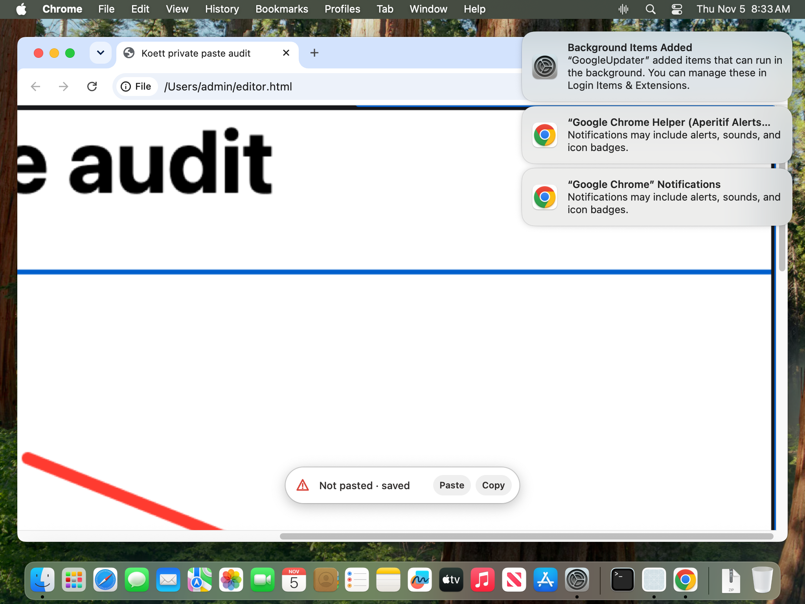
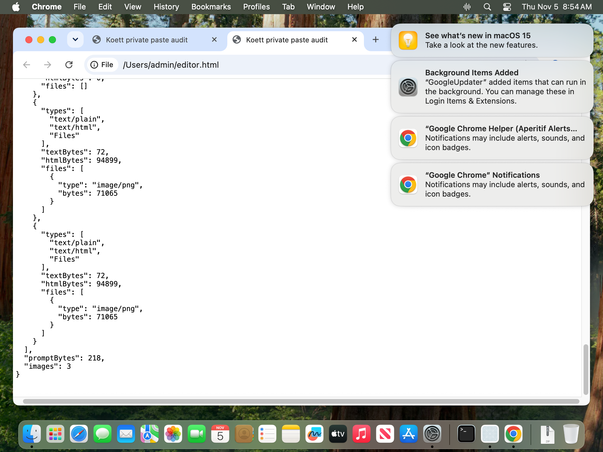

# Linux v0.3.0 first-install audit

**Decision: NO-GO. No tag or release was created.**

Audit date: 2026-11-05 UTC. The functional results below are candidate evidence,
not acceptance of a final release. PASS applies only to the stated observation;
NOT TESTED includes invalid or incomplete harnesses. A broken lab is not a
product failure, and a startup test is not a complete first-install journey.

## Final-candidate staging status

All planned product fixes are merged, including M2/#78, performance #102/#108/
#109, Mac #105/#110/#111/#114/#115/#116 and GNOME #117/#118. The GNOME stop-key
fix passed all six native CI checks and review before merge. Its packaged retest
will use the final candidate instead of another intermediate package.

The source is not frozen at this staging snapshot. Merge the updated final
changes in order (#90, this audit, then #103 version metadata), with each head
green. M3/#113 stays outside this release. Announce the full frozen SHA immediately,
build Mac and Linux from it, and test those exact assets. Record post-freeze
results in separate evidence so the shared source identity cannot drift.

The historical FAIL/NOT TESTED rows below retain their original candidate scope;
the later superseding receipts identify what was fixed and verified. The final
release remains NO-GO until final-asset acceptance, Mac readiness and the explicit
release decision. No tag or publication is authorized by this staging report.

## Candidate identity and isolation

Latest repeated clipboard/drawing checks used the release-style system-runtime
archives from [CI run 41943679213](https://github.com/oEdyb/koett/actions/runs/41943679213),
source `f2c3238da6b0c8134c76eba410bc292f2d63f1d5` (the paste-latency merge candidate):

- `Koett-Linux-x86_64-system-runtime-f2c3238d.tar.gz`
- `Koett-Linux-aarch64-system-runtime-f2c3238d.tar.gz`

Both sidecar checksums and native receipt identities were checked. These archives
predate the merged provenance-path fix and still contain those paths. **Do not
publish them.** The final approved commit and freshly built assets remain a gate.

Earlier follow-up checks used source `54dc92865bc5b8cb94060b441e1c6e9406ac8cf0`
from [run 41940218945](https://github.com/oEdyb/koett/actions/runs/41940218945).
Production changes between those two candidates affect `linux.rs`,
`linux/clipboard_owner.rs` and `linux/output.rs`; model download, capture and draw
key modules are unchanged. Model/network evidence below refers to that earlier
candidate explicitly. Initial installer/adverse-condition checks used
`eb6f2d6e896497d7e7e1c527aa8bba88ec23ee50` from
[run 41936332855](https://github.com/oEdyb/koett/actions/runs/41936332855).
The upgrade input was the actual published v0.2.0-linux.1 x86-64 archive.

[Initial receipts](evidence/release-v0.3.0-audit/receipts.json),
[initial privacy scan](evidence/release-v0.3.0-audit/privacy-scan.json) and
[follow-up receipts](evidence/release-v0.3.0-audit/followup.json) distinguish these
sources. Public receipts contain hashes and observations, not raw screenshots,
OCR output, local home paths or History text.

No installed Koett, visible desktop, host clipboard, host microphone recording,
physical keyboard permissions or host group membership was changed. Tests used
fresh homes, private buses/audio, disposable containers and invisible compositors.
A named, grabbed virtual keyboard supplied drawing gestures; this does not prove
physical-keyboard setup on a normal login. Builds/checks used nice 15, two jobs,
an 8 GiB scope and cache output outside /tmp. No installed app was replaced.
The desktop lab and test containers were stopped before the performance audit
received the exclusive desktop slot.

## Desktop and architecture coverage

| Check | Result | Evidence and limit |
| --- | --- | --- |
| x86-64 and ARM64 archives | PASS | Latest archives match their sidecar hashes and source receipt. |
| ARM64 native CI | PASS | Both candidate runs passed the native ARM64 job, including native linking, inference and archive validation. CI is not desktop acceptance. |
| ARM64 desktop, all environments | NOT TESTED | No ARM64 desktop hardware/emulator journey. Release notes must state ARM64 desktop use is untested. |
| KDE Wayland lab validity | PASS | Rebuilt with identical fresh HOME/XDG for compositor, portals and app. Native permission dialogs work. The earlier alternate-HOME identity mismatch was a lab defect. |
| KDE from zero | PASS, limited | Archive installer into fresh HOME; first model download reached Ready; Settings and History exercised. Instrumented private seat, not a new physical-machine login. |
| niri | PASS, limited | Actual nested niri, private audio, real Chrome and kitty consumers. Model supplied in this session. Static screenshots work; screencast capability is not implied. |
| GNOME | PASS, limited | Rebuilt real GNOME 51.1 shell with private system bus/logind fixture and software renderer. App UI, Ready model and fixture ASR saving one row work. Drawing unavailable without disrupting dictation. |
| GNOME complete install/permissions/paste | NOT TESTED | Private logind fixture is not a display-manager login; full permission decisions, shortcut setup and portal paste remain open. |
| Plain X11 | PASS, limited | Fresh UID-1000 Xvfb startup, shortcut backend, offline and no-mic error handling. Full desktop workflow and unsupported-overlay acceptance remain open. |

KDE 6.8.2 screenshot capture initially returned a generic backend error because
the synthetic HOME lacked its Pictures directory. Creating the normal Pictures
user directory fixed the lab; no application workaround was added. Permission
Deny and Allow were exercised separately. This does not establish behavior on
every KDE distribution or on a real user's existing portal permissions.

## Functional workflow

Unless stated otherwise, desktop results are x86-64 only. None applies to the
unselected final tag. Latest means the `f2c3238d` candidate above.

| Check | Result | Evidence and limit |
| --- | --- | --- |
| Drawing off by default | PASS | Fresh KDE Settings shows unchecked drawing; ordinary fixture dictation works. |
| Enable through Settings | PASS | Native pointer toggles drawing; Save and reopen retain the enabled state. Other settings pages/mic switching are not exhaustively accepted. |
| Hold Shift and move; repeated holds | PASS | KDE and niri real pointer/key gestures produce separate sketches and captured PNGs. Uses grabbed test keyboard, not a physical keyboard. |
| Shift+click pins | PASS, limited | Latest KDE Chrome/Electron each receive a two-annotation sheet plus linked text and window context. Latest niri Chrome also consumes a sketch and pin. Selection-denied and all context permutations remain open. |
| Ctrl+Alt+D lock; undo; exit; stop | PASS, limited | Earlier candidate: actual chord locks; two drag strokes form one sketch; right-click undo and chord unlock; image/text consumed. Latest KDE repeats chord/drag/undo/unlock with one captured group and saved result; latest lock-specific consumer export was not separately retained. |
| Browser image/text paste | PASS, limited | Latest real Chrome fresh profile receives PNG then linked text. Repeat Ctrl+V exposes coherent HTML/plain/image bundle with identical image bytes and text. Custom paste target, not every browser editor. |
| Electron image/text paste | PASS, limited | Latest actual Electron app receives PNG then linked text; repeat paste preserves exact bundle. Custom editor fixture, not acceptance of every Electron application. |
| Terminal image/text paste | PASS, limited | Latest niri kitty raw TUI consumes a 30,655-byte 1600×906 PNG through its image-aware Ctrl+V handler; Ctrl+Shift+V text matches saved result. Restored clipboard PNG/text match exactly. A shell alone does not accept images. |
| niri fallback and clipboard restoration | PASS, limited | Actual Chrome consumption and earlier repeat-paste bundle checked; latest terminal verifies restored image/text. Does not measure stop-to-paste latency or sustained soak. |
| Focus change before paste | PASS, earlier candidate | Settings steals focus; terminal remains unchanged; final transcript saved and clipboard-only delivery used. Latest latency fix needs its independent performance/focus checks. |
| Screen capture grant/deny | PASS, limited | Valid KDE native dialogs: denial/timeout preserves dictation text; grant plus normal Pictures directory permits captures. GNOME permission UI remains open. |
| Keyboard denied | PASS, limited | Revoke access to the owned virtual keyboard before latest app launch: drawing inactive, no image, plain dictation still pasted to Chrome. Restore ACL afterward. No host physical device changed. |
| Keyboard group access | PASS, kernel scope | Disposable user cannot read before setup; fresh process with private keyboard group can read, cannot write; owner/input group unchanged; restoration removes access. Actual udev hotplug and logout/login not tested. |
| Microphone permission grant/deny | NOT TESTED | Synthetic private audio and no-device errors do not prove hardware/portal microphone permission decisions. |
| History search | PASS | Missing query gives No matches; fixture query returns saved rows. |
| History Copy and Export | PASS, limited | Both produce exact text from saved synthetic database rows; native export chooser writes a file. The two actions selected different rows, so same-selected-row equality is NOT TESTED, not claimed. |
| Populated old-version History migration | NOT TESTED | Existing upgrade test preserves a marker, not a populated synthetic old database/search/export journey. |

Fixture ASR occasionally changes punctuation or repeats a syllable. Clipboard
comparisons use the actual saved result rather than pretending the recognized
phrase is a perfect transcript of the source audio.

## Installation, downloads and adverse conditions

| Check | Result | Evidence and limit |
| --- | --- | --- |
| README base requirements | FAIL, fix proposed here | Initial bare Ubuntu missed Python and optional layer-shell instructions. This PR supplies package names. Full final-README walkthrough remains open. |
| Runtime package install | PASS, initial candidate | Ubuntu 22.04 base package command, runtime preflight, installer, menu-help and archive verifier pass. Container root for base package setup, not desktop acceptance. |
| Fresh unprivileged install | PASS | UID 1000 installs into empty HOME and launches packaged app. KDE fresh HOME also uses archive installer. |
| Archive installer checks | PASS, initial candidate | Integrity rejection, required loader rejection, prefix spaces/dollar, reinstall/backup and running-old-process preservation. |
| Upgrade from v0.2.0-linux.1 | PASS, limited | Actual old archive then candidate in isolated prefix; version directories and synthetic settings marker retained. Real-shaped populated settings/History still open. |
| Failed network | PASS | Fresh no-network X11 shows error and Retry while staying alive. |
| Slow/interrupted network recovery | PASS, earlier follow-up candidate | Container link shaped to 150 ms/2 Mbit/s; partial download appears. 100% packet loss gives receive-body timeout and Retry, removes partial files. Restore link and Retry: Ready in 14.4 s, no partial files. No app-level cancel/resume claim. |
| No GPU | PASS, limited | Software-rendered GNOME with no GPU devices performs actual CPU fixture ASR and saves one row. No latency/minimum-spec claim. |
| No microphone | PASS, limited | Fresh X11 stays alive with device-format error and Retry. Unplug/replug recovery remains open. |
| Small disk upgrade | PASS, initial candidate | Disposable 192 MiB filesystem ENOSPC: old launcher/data survive, no staging leftovers. Model-download ENOSPC remains open. |
| 512 MiB RAM startup | PASS, limited | Compact model loads and no-mic error remains recoverable. |
| 512 MiB inference / OOM recovery | NOT TESTED | Attempted private audio graph times out creating its stream; no saved transcript. Invalid inference harness, not evidence of app OOM or acceptable inference. |
| Manual uninstall | PASS, file scope | Launcher/desktop/icon/version removal in disposable prefix preserves data. Autostart and keyboard ACL revocation not exercised. |
| Final download/installer/identity | NOT TESTED | Final commit, Mac ZIP and rebuilt Linux assets not yet selected or approved. |

## Public repository and privacy

| Check | Result | Evidence and limit |
| --- | --- | --- |
| Published download includes drawing | FAIL | Existing stable Mac and Linux downloads predate drawing. No release created. |
| Drawing-first docs | FAIL, pending merge | [PR #90](https://github.com/oEdyb/koett/pull/90) documents opt-in, controls and honest current-download status. |
| Support/security intake | PASS | [PR #94](https://github.com/oEdyb/koett/pull/94) merged; bug form and private security link included. Reporting enabled; no report sent. |
| Notice validation | PASS | Merged notice inventory validates all 700 indexed files; eight notice tests pass. Not a legal opinion. |
| Packaged personal paths | FAIL for tested archives | Merged #94 redacts provenance, but old candidate archives still contain original paths. Fresh artifacts required. |
| Current-tree path/screenshot cleanup | PASS, current-tree scope | [PR #101](https://github.com/oEdyb/koett/pull/101) merged: redacts 126 text files and removes three inspected screenshots. Original count was 125; later document added one. |
| Full-history secret scan | PASS, detector scope | Gitleaks 8.30.1: 367 fetched public commits, five findings across four evidence JSON files; original values checked, all library/source SHA-256 digests. No credential confirmed. Not proof of no sensitive prose. |
| Historical screenshots | PASS, limited review | OCR of 656 unique reachable image blobs flags only same three path screenshots. Those three visually inspected: synthetic browser geometry, empty History/settings error, synthetic drawing target. Account/home/project/test paths exposed; no credential or personal transcript visible in them. |
| Personal transcript or other sensitive historical content | NOT TESTED exhaustively | No additional credential/private transcript confirmed; OCR and secret detectors cannot certify every pixel or prose passage. No history rewritten. |
| Clone size/time | PASS, measurement only | Initial full public clone 2.67 s; Git files 33,070,644 bytes, worktree 59,784,104 bytes. One network/time, not a guarantee. |
| Probe compilation regression | PASS | #93 merged; #95 closed as identical duplicate. #94 subsequently passed all six checks and merged. Earlier failing import is no longer an open source defect. |
| Linux displayed release version | FAIL, fix proposed | [PR #103](https://github.com/oEdyb/koett/pull/103) changes root package/inventories to 0.3.0; candidate still displays 0.2.0-linux.1. |

[Privacy detail in PR #101](https://github.com/oEdyb/koett/pull/101) records exact
removed filenames, visible contents and detector limits. Stop committing raw
evidence by default: keep reviewed small receipts/synthetic fixtures in Git;
use private artifact storage for raw captures. Public CI artifacts need the same
sanitation as Git. Existing evidence is not deleted wholesale, and history
rewriting remains a separate owner decision.

## Targeted resumed checks

[Resumed receipts](evidence/release-v0.3.0-audit/resumed-gates.json) supersede
these earlier NOT TESTED rows for candidate `f2c3238d`:

- **PASS — populated upgrade/History:** installed actual v0.2.0-linux.1,
  initialized its database, inserted three synthetic records, then installed the
  candidate. Settings survived; all three records remained after restart;
  database integrity returned `ok`; native History search displayed the records.
  This is synthetic migration evidence, not import of personal data.
- **PASS — autostart/uninstall, file and app scope:** menu-login on/off created
  and removed the desktop entry, which points to the stable installed launcher.
  App restarted successfully. Documented app removal removed launcher, icon,
  desktop entry and versions while preserving settings and database bytes.
  Actual display-manager login and physical-keyboard ACL revocation remain scoped
  hardware/session limits.
- **PASS — 512 MiB short inference:** repaired the private audio harness using
  PulseAudio. One copied compact-model sample was recorded and recognized; one
  row saved; app alive; container memory peak 450,969,600 bytes. No GPU or physical
  audio devices. This supersedes the earlier failed harness attempt. It is not
  a minimum-memory promise, other-model OOM test or long recording benchmark.
- **PASS — X11 ordinary dictation/paste:** fresh Xvfb session, private audio,
  one sample, actual GTK text field receives exact saved text. No GPU. Drawing
  unavailable as expected. This verifies native X11 delivery in a synthetic
  session, not every X11 window manager or application.
- **FAIL — model destination ENOSPC diagnostic:** 8 MiB disposable data
  filesystem, copied real model release cache, network disabled. App remains
  alive, shows Retry and removes partial files, but cache write ENOSPC is hidden
  by a later DNS error. [Fix #112](https://github.com/oEdyb/koett/pull/112)
  preserves destination errors without trying another source. Two targeted
  cache-routing tests pass; native CI and integrated packaged-app retest remain
  required. No new model download or large benchmark was used.

- **NOT TESTED — complete GNOME paste journey:** latest candidate installs,
  reaches Ready and saves one sample transcript in real headless GNOME; drawing
  stays unavailable. The native GTK consumer did not receive the result.
  Delivery reports `clipboard_pending`: the programmatic start/stop harness
  lacks an actual focused-user input serial. This is not a valid substitute for
  native Record interaction. Full GNOME paste/shortcut permission acceptance
  needs an interactive login/session; no product-failure claim from this probe.

- **PASS — packaged ENOSPC fix retest:** #112 merged at
  `8b78b51e30c50e165a066cc180e5ff9df86cc11f` after all six CI checks passed.
  Downloaded its CI archive from run 41996617103, source
  `e40ca27625c70a6449b56a6d6b708277b776c57b`, and verified the sidecar checksum.
  Repeated the 8 MiB data-filesystem check using copied archive bytes, no network.
  The visible error now reports No space left on device; Retry remains available,
  app stays alive and no partial files remain. Cache aliases cover both model
  names; capacity failure occurs before digest validation. This supersedes the
  earlier ENOSPC diagnostic FAIL. Final-asset rerun remains separate.

## Interactive GNOME VM follow-up

**PASS, local compatibility build — GNOME 46 Wayland dictation and native paste.**
[Receipt](evidence/release-v0.3.0-audit/gnome46-compatibility.json).

The bounded follow-up used QEMU/KVM, four virtual CPUs, 7,680 MiB guest RAM,
a real virtual keyboard/tablet and a fresh generic Ubuntu 24.04.4 live user.
The ISO SHA-256 matched the official sidecar. No second OS image or model was
downloaded. The model/audio were copied fixtures. All VM files remain in private
cache storage. The initial live desktop used X11; the accepted run explicitly
used the real Wayland login and native Wayland GTK clients. Stale activation
environment from the live session was corrected before acceptance.

Two real compatibility failures were found, rather than accepted as lab limits:

- The optional focus extension declared only Shell 51 compatibility. Ubuntu's
  Shell 46 therefore supplied no guarded target identity.
- Ubuntu's portal lacked the newer host Registry interface. Koett rejected the
  whole paste session before showing its otherwise available permission dialog.

[PR #117](https://github.com/oEdyb/koett/pull/117) adds Shell 46 focus support and
skips only the exact missing Registry interface. Other registration errors still
fail. Unsupported pill APIs remain disabled on Shell 46; drawing remains
unsupported. Linux packages now include the optional extension and setup guide.
The desktop extension must be explicitly installed/enabled and the user must log
out/in. GNOME's settings backend configured a custom `koett toggle` shortcut;
QEMU Ctrl+Shift+Space actually started and stopped recording in the focused editor.

The native Remote Desktop dialog was approved with both Remote Interaction and
Clipboard Access enabled. Accessibility checkbox/Share actions completed the
permission grant after the pointer attempt did not. These were the real portal
controls, not a mocked grant. Koett captured the editor's focus token and required
the same token immediately before posting paste. GNOME Text Editor received the
recognized result. Its actual native Save dialog wrote 124 transcript bytes plus
its normal final newline; this matches the latest History result exactly.
An initial accessibility-text probe lacked the editor text interface, so file
content and the visible editor—not that failed probe—establish consumption.

The release build was made in the existing Ubuntu 22.04 build container under
nice 10, four jobs and a 12 GiB build scope. Two focus identity/safety tests pass;
one old named-lab test is skipped. The local archive installer verifier passes
extraction, loader validation, isolated install, spaces/dollar in prefix,
reinstall/backup, old-process preservation and tamper rejection. All four GNOME
integration files appear in the archive manifest with correct hashes.

This supersedes the headless GNOME paste NOT TESTED result for this specific
local fix. It is not final-asset acceptance: #117 still needs review/native CI
and a packaged approved-source rerun. Shell 51 behavior has historical evidence;
this VM is not a new Shell 51 test. Permission denial/recovery was not separately
accepted here. No host desktop, installed app, physical keyboard/mic, tag or
publication was changed. The Mac audit below is preserved from main.

## Approved-package GNOME retest: new stop-key blocker

**FAIL — standard held stop chord on the exact merged #117 package.**
[Receipt](evidence/release-v0.3.0-audit/gnome-stop-modifiers.json).

Consumed [CI run 42005375914](https://github.com/oEdyb/koett/actions/runs/42005375914),
source `e3637778b9e65edacc02b7610a05618d74eac98e`. The archive SHA-256 is
`a8379c3c3f7fd1f740caa81991a8dbfa710a1b083d73bc09f01234664b0f0898`;
sidecar, all package hashes, clean candidate source stamp and installed binary
hash match. Installed the extension from that same archive, relogged into real
GNOME 46 Wayland, configured the desktop shortcut and approved the native portal.
No local binary was substituted for this approved-package test.

With QEMU's Ctrl+Shift+Space stop chord held for 80 ms, portal delivery reported
success but the real GTK editor stayed blank. Manual Ctrl+V recovered the text.
A targeted 10 ms release pasted automatically. The old guard had no modifier
state in this ordinary user setup; it could post before shortcut release.
A fast-release success does not close the normal stop-chord failure. This
supersedes the earlier local-build GNOME PASS as release acceptance.

[PR #118](https://github.com/oEdyb/koett/pull/118) returns the modifier mask in the
existing authenticated extension focus reply. The bounded guard waits for release
and checks fresh focus/modifiers together immediately before posting. It adds no
fixed delay. An old extension without modifier state fails closed to recovery;
the app and copied extension must be updated together.

**PASS, local fix only:** the original 80 ms native stop chord now automatically
pastes into GNOME Text Editor. Native Save wrote 119 transcript bytes plus the
editor's normal final newline, matching History. The post trace reports the same
focus token and zero held modifiers. Three identity/modifier tests and eleven
paste-guard tests pass; one historical named-lab test is skipped. Invalid
relogin/display, silence and own-window-focus attempts were discarded.

This local frontend check used the cached pinned ASR library without the newer
shared-context patch; no dictionary terms were used. Full patched-native CI and
approved-package acceptance of #118 remain gates. The VM is stopped. No benchmark,
new model download, host installed-app change, source freeze, tag or publication.

## Remaining Mac checks by platform-owner handoff

Hardware/live-profile acceptance requires a person to:

- Start/stop with physical left and right Option, draw/pin with Shift, and verify
  normal typing/chords remain intact.
- Dictate through built-in and iPhone microphones, switch/disconnect a device,
  and confirm visible recovery.
- Check automatic drawing delivery and two repeated Cmd+V pastes in the actual
  live T3 composer, retaining image and text each time. An isolated full-composer
  check is still possible and is not replaced by this live-profile check.

Final frozen-source ZIP build/notarization/launch, throttled network retry and
v0.1.1 TCC/login-item upgrade remain software checks owned by the Mac build path;
they do not require physical input and are not delegated to the user.

## Remaining release gates

1. Merge reviewed docs/privacy/version fixes; finish independent dictionary
   performance gate (at most 10% overhead or slow acoustic pass disabled by
   default), stop-to-paste measurements, drawing/pin overhead and live soak.
2. Select the approved source commit only after fixes land. Rebuild Linux x86-64,
   Linux ARM64 and Mac ZIP from that identity, verify all checksums/notices and
   native CI, and repeat changed-path checks on those exact assets. Mac signing,
   notarization and screen permission acceptance require their own receipt.
3. Complete final README from zero with physical login/keyboard permissions,
   review/CI and approved-package acceptance of the GNOME stop-modifier fix (#118).
   The packaged ENOSPC fix now passes; GNOME local-build acceptance is above.
   Targeted X11, populated upgrade, autostart/uninstall and short low-RAM inference
   now pass within the scopes above.
   Explicitly state ARM64 desktop use remains untested unless hardware runs it.
4. Resolve every remaining NOT TESTED item by valid evidence or an explicit
   support limitation; do not silently turn a lab probe into full acceptance.
5. Obtain explicit authorization for the tag and publication. Attach the Mac ZIP
   alongside both Linux archives and matching checksums. No tag before approval.

Decisions: drawing remains opt-in; candidates and final release are distinct;
raw evidence remains private; no dictionary defaults, installed app, physical
keyboard access or Git history were changed. The performance audit now owns the
exclusive lab slot; remaining documentation work needs no desktop load.

---

# v0.3.0 Mac first-install audit

Status: **NO-GO; audit in progress**. No GitHub release has been published.
Results distinguish the distributed app from tests of its source and dependencies.
A passing component test does not certify the corresponding first-install flow.

## Candidate and environment

- Current audit candidate: `ece9c25b3eb19acf5c11145ca6358926ca81a86a`, including
  the capture-failure warning. Version/build come directly from source: 0.3.0/3.
  SHA-256: `b1f628201e87c22531aee59b567aa951f3fc68893bf9876d8ae14e55986a2e7f`.
  Submission `a279c20d-ecec-46e2-aef5-bd8f3f723b65`: **Accepted**, stapled.
  A separate quarantined extraction passes strict codesign, stapler and spctl
  (`accepted`, `source=Notarized Developer ID`). Executable UUID:
  `F5C7EEDC-DA37-3225-B230-B9054B35E6A8`. Guest GUI results below are partial; this is not the final release artifact.
- Initial candidate: `eb6f2d6e896497d7e7e1c527aa8bba88ec23ee50`.
- ZIP: `Koett-0.3.0-macOS-arm64.zip`, SHA-256
  `48d5e1c3711ffc8cc403da235638114e9f7b5d1f07e805ff506d45ba8c07e020`.
- The initial candidate's staging metadata overrides version/build to `0.3.0`/`3`.
  [PR #92](https://github.com/oEdyb/koett/pull/92), merged as
  `61e121e13044a7eb1df8d4ebf3fb8b1a889884d3`, puts these values in source and
  includes drawing/pins in the existing Screen Recording purpose string.
- Developer ID: `Dyberg & Co AB (LF8KF3G42Q)`, hardened runtime, secure timestamp.
  Notarization submission `199a472d-2842-4b71-ba19-fa831ddc0412`: **Accepted**.
- Host: Apple M5, arm64, macOS 26.6.2 / `25G83`, 2026-11-05.
- Extracted the actual candidate ZIP into a new temporary directory, added quarantine,
  and launched its executable with `CFFIXED_USER_HOME` pointing to a fresh, short
  test directory. Foundation's resolved home and Application Support paths were
  checked before launch. No real transcript, preferences or clipboard text was
  used as a fixture. The installed app was not replaced.
- Clean Tart guest: macOS **15.7.7 / 24G720**, public test account `admin`,
  isolated from host clipboard, audio and display. The downloaded base image had
  Gatekeeper disabled; assessments were explicitly enabled before first open.
  Candidate ZIP copied to Downloads, extracted and moved into guest `/Applications`.
  Neither the installed host app nor its data was changed.
- The audit guest is stopped while a separate performance run owns the shared
  machine. Remaining runtime gates resume after its exclusive slot is released.
  Final packaging must use the final source commit supplied for the release.

## README-only route

The README says: download the latest Mac release, unzip, move to Applications,
open, allow Microphone/Accessibility, wait for the model, then toggle either
Option key to dictate. Configuration is in the menu bar.

The public `latest` download currently resolves to **v0.1.1**, which has no
drawing. The local candidate substitutes for that download in the tests below;
this is an explicit deviation from the stranger's current route.

## Results

| Check | Result | Evidence and limit |
|---|---|---|
| README download delivers drawing | **FAIL** | `gh release view v0.1.1`: current public Mac ZIP is the August v0.1.1 artifact. Publication remains deliberately pending. |
| Actual ZIP integrity | **PASS** | Extracted candidate ZIP; checksum above. App version 0.3.0/build 3 and source stamp match the candidate. |
| Developer ID signature | **PASS** | Extracted app: `codesign --verify --deep --strict --verbose=2` returns 0; arm64, team LF8KF3G42Q, hardened runtime and timestamp verified. |
| Notarization ticket | **PASS** | Extracted app: `xcrun stapler validate` returns 0; `codesign -d --verbose=4` reports `Notarization Ticket=stapled`. |
| Gatekeeper assessment | **PASS** | Quarantined extraction: `spctl --assess --type execute --verbose=4` returns 0, `accepted`, `source=Notarized Developer ID`. The clean macOS 15 guest also passed assessment with Gatekeeper enabled, then displayed the normal first-open confirmation and launched after approval. |
| Move into `/Applications` in a clean guest | **PASS** | Actual candidate ZIP extracted and moved into guest `/Applications/Koett.app`; normal first-open confirmation approved and process launched. Host installed app preserved. |
| First GUI process launch from ZIP | **PASS** | Extracted executable remains alive; isolated `--control status` returns exit 0, `ok:true`, `model:parakeet`, `phase:loading`, `pasteAccessGranted:false`. Stops at missing access; not a ready/dictation pass. |
| Permission onboarding layout/state | **PASS** | `PermissionsTests` pass; six offscreen light/dark first-launch, relaunch-needed and allowed renders inspected. These are fixtures, not system dialogs. |
| Microphone allow, deny, later recovery | **NOT TESTED** | Real guest denial settles to Open Settings; granting through Settings produces Quit & Reopen and TCC changes to allowed. Real BlackHole capture and native automatic paste now pass after natural grants. Early microphone prompt reproduced in the old build and removed by PR #107 in a same-guest comparison. Capture passed with generated BlackHole audio; physical microphone acquisition remains untested. |
| Accessibility allow, deny, later recovery | **NOT TESTED** | Guest Allow opens the actual Accessibility pane and denied/ungranted state settles to Open Settings. Natural Settings grant and authentication now succeed; app status reports paste access. Actual native paste succeeds after that grant. No new host grant was requested; a trusted flag alone does not prove delivery. |
| Screen Recording allow, deny, relaunch | **PASS (partial)** | Guest Settings grant, authentication, Quit & Reopen and actual capture-bypass Allow exercised. Real drawing/pin captures succeed. Revocation and bypass refusal recovery remain untested; no host grant requested. |
| Cold default model download and inference | **PASS** | Pinned FluidAudio through `parakeet-baseline`, fresh test home/model directory: download/load/warm-up succeeds; generated 3.32 s speech transcribes exactly. This bypasses the app's onboarding/UI. |
| Failed network and Retry Setup UI | **NOT TESTED** | Dependency probe against refused localhost endpoint exits 1 with `Could not connect to the server`, preserving cache. A private source build in the clean guest received HTTP 503 from a guest-only registry fixture, then exposed Show Error and Retry Setup menu actions. Retry restarts requests; a subsequent direct-registry launch downloads/loads successfully. End-to-end same-attempt retry completion remains untested. |
| Slow network progress, interruption/resume UI | **NOT TESTED** | Loader probe progressed through a throttled private proxy, retained a partial file after interruption, and subsequently loaded/transcribed successfully. Cached inference also passes with the registry unreachable. Actual guest Checking/Loading UI observed, but a continuously throttled app download and HTTP Range reuse remain unverified. |
| First Option-key microphone dictation and paste | **NOT TESTED** | Source capture/delivery tests pass; no generated audio has yet completed this full flow in the clean GUI. |
| Draw & Pin option included | **PASS** | Exact label exists in extracted binary, production source and actual guest menu accessibility tree. Drawing while ready is still untested. |
| Drawing and pin capture/paste | **PASS (partial)** | Actual Shift-drag ink, Shift-click pin, menu/CLI undo, ScreenCaptureKit capture and Chrome image/text delivery exercised. Initial text-stage failure fixed in #111; see guest receipt. Multi-display and physical gestures remain unverified. |
| Repeat native paste, isolated T3 editor | **PASS** | Real macOS clipboard, hidden Electron 44.10.1 and matching T3 editor/intake: automatic image then text; two native `webContents.paste()` repeats each retain both. Details below. |
| Reported image-only repeat in full T3 chat | **NOT TESTED** | Failure not reproduced; original failing clipboard was already replaced. Full ChatComposer state and desktop Cmd+V routing were outside the isolated editor test. |
| Settings/menu interaction | **PASS (partial)** | Actual Draw & Pin toggle, Undo Last Drawing and permission actions exercised; draw setting survives app replacement/relaunch. Full settings/input/model-switch matrix remains untested. |
| History UI and search | **PASS (partial)** | Actual native History window loads three generated dictations, matching database count. Search/copy/export pointer flows remain untested. |
| v0.1.1 history/preferences preservation | **PASS** | Actual old ZIP checksum matches public v0.1.1. Fixture generated by its exact `c72f834` TranscriptStore source; actual candidate imports it. Two launches yield one identical searchable archive row; original Markdown, last transcript and preferences are byte-identical. |
| v0.1.1 permission/login-item upgrade | **NOT TESTED** | Old/new Developer ID designated requirements match; no real TCC/login-item migration was performed. |
| Uninstall preserves data | **PASS** | Removing only the test app leaves its History database and original files intact. Real Finder Trash and Login Item cleanup remain untested. |
| Intel Mac | **NOT TESTED** | Binary is arm64 only, consistent with README Apple silicon requirement. No Intel machine or actual rejection dialog was exercised. |
| macOS 15 runtime | **PASS (partial)** | Actual ZIP launches on 15.7.7, shows onboarding and opens privacy Settings. Generated audio capture, plain paste, drawing and Chrome repeats pass in the private source builds. Exact macOS 15.0 and final ZIP were not exercised. |
| macOS 26 runtime | **PASS** | Isolated launch/status and native clipboard/editor probes above. Full clean-user dictation/drawing is still untested. |

## Repeat-paste finding

Running T3 Router was 0.1.25, source `37ace3264c90`, which includes
`1d4662546a`. Its running process held the inspected ASAR; this was not merely
an on-disk version check. The original image-only failure remains unresolved.

The production clipboard probe leaves **one item** with UTF-8 plain text,
PNG, TIFF, and HTML containing both the embedded PNG and escaped text. A generated
1024×1024 image produced 3,696,861 PNG bytes, 4,929,290 HTML bytes and 61 plain-text
bytes. After automatic delivery, two native repeats expose `text/plain`,
`text/html`, and `Files/image/png`. Prompt bytes grow 61 → 122 → 183; three images
are accepted. No synthetic ClipboardEvent or user-window input was used.

This rules out an inherent single-item macOS format incompatibility for this
fixture. It does not rule out full-composer insertion/remount/draft rollback.
T3 needs a shared paste-event ID and metadata-only tracing at capture, Tiptap
insertion/onChange and post-attachment draft commit. Record types, MIME/byte
lengths, `keepText`, cancellation flags, editable/selection availability and draft
identity; never record clipboard contents.

## Actual guest paste failure and fix

[Guest receipt](evidence/release-v0.3.0-mac/guest-paste.json).
A private source build on macOS 15.7.7 reproduced a separate **automatic** sketch
paste failure: image posted, then text waited 1,513 ms and refused with
`modifiersHeld`. The existing persistent Not pasted/Paste/Copy recovery appeared.
The native probe shows that posting V key-up with Command still set updates HID
modifier state even from a private CGEvent source. Clearing key-up flags leaves
Command released. [PR #111](https://github.com/oEdyb/koett/pull/111), merged as
`d53be9c0bfa85412ed6f83a7dbfff34c0e4950a0`, ends the synthetic chord on key-up.
The patched guest app posts both stages; text readiness waits zero milliseconds.
Two native Chrome Cmd+V repeats each expose image + plain text + HTML and retain
all three images plus prompt text. This does not establish the historical full
T3 composer failure's cause.

The guest has no newly added Input Monitoring grant. Synthetic Option events did
not toggle dictation, so start/stop used the public local-control interface; this
is actual recorder/ASR/paste evidence, not physical shortcut evidence. The Mac
pill's specified hover row contains Cancel/Pause/History and has **no Stop
button**. Clicking its recording dot does not stop; that requested path cannot be
claimed tested or working without a product change. Pill rules remain intact.

## Paste timing baseline

[Host probe receipt](evidence/release-v0.3.0-mac/host-probes.json).
No image-consumption timeout/settle policy has changed. PR #111 separately removes
the self-generated Command state that could block text after image delivery. Two generated fixtures used production staged
delivery and the matching T3 editor/intake in hidden Electron 44.10.1:

- Small image: image-to-text event-post gap **191.2 ms**; image paste intake to
  text insertion **199.8 ms**.
- 3.70 MB PNG: event-post gap **177.6 ms**; intake-to-insertion **177.4 ms**.
- Both retain image/text through two repeats. These are two fixture observations,
  not latency percentiles, CPU-load trials or visible screen presentation times.
- A separate generated, named-pasteboard fixture measured the production image
  wait with a read after posting: **161.5–167.4 ms** across three runs.
- Reading the image before the post timestamp caches its bytes. A later consumer
  read then produces no new provider callback, so the same code waits its full
  timeout: **1,668.4–1,672.8 ms** across three runs. This reproduces a slow path,
  not the original live T3 report. Clipboard-manager activity can create this
  ambiguity; readiness waits are a separate possible contributor.

Keep image-first order, focus checks and newer-copy ownership. Shortening an
unobserved-read fallback needs slow-reader and target-consumption evidence;
normal measured consumers already hand off near 200 ms.

## Fixes found during this audit

- [PR #92](https://github.com/oEdyb/koett/pull/92): source bundle version and
  Screen Recording explanation. 426 tests, 10 skips, release build and packaging
  checks pass. No new permission requests.
- [PR #98](https://github.com/oEdyb/koett/pull/98): failed or timed-out captures
  previously disappeared while successful text delivery showed ordinary Done.
  Session-scoped failure state now keeps an explicit warning, without discarding
  surviving images/text or overwriting Not pasted. Four regression tests pass;
  430 tests (10 skips), release build and packaging checks pass. Merged as
  `ece9c25b3eb19acf5c11145ca6358926ca81a86a`. Pill geometry and permission
  requests are unchanged. The current audit candidate includes this fix;
  the initial candidate is superseded.

- [PR #106](https://github.com/oEdyb/koett/pull/106): the floating permission
  window covered the real System Settings Quit & Reopen dialog. The permission
  window now uses normal ordering. In the same macOS 15 guest, the private test
  build's window is layer 0 and the OS modal is fully visible. 430 tests (10 skips),
  release build and packaging checks pass. Merged as
  `a764b51ad20408d61c550efee8a88cab4391a501`. This fix is not in the candidate ZIP.

- [PR #107](https://github.com/oEdyb/koett/pull/107): eager audio playback
  initialization could show the microphone prompt before onboarding. Recording
  sounds now prepare after required permissions; optional spoken replies create
  their audio graph only when valid audio arrives. Three new regression tests;
  433 tests (10 skips), release and static packaging gates pass. Merged as
  `4e15ab806e40cd26ed683c5c8e0b85b54cae2011`. Same-guest reset-permission
  comparison: original build prompts before local control exists; private source
  `f140724db4d65a957810cd1a2ba84de5bd589530` shows onboarding with Allow Microphone
  and local control first. The system prompt appears after explicit Allow.
  This fix is not in the candidate ZIP; no new permission type was added.

## Guest evidence

Local receipts are retained under
`/Users/olle/dev/koett-release-artifacts/v0.3.0/ece9c25/guest-output/`:
`os-version.txt`, `codesign.txt`, `stapler.txt`, `gatekeeper-assessment.txt`,
`first-open-dialog.png`, `microphone-denied-settled.png`,
`permission-request-settled.png`, `ax-settings-after-mic-grant.png` (covered modal),
`window-order-fixed-relaunch-dialog.png` (fixed modal),
`eager-audio-ab-original.png`, `deferred-audio-first-open.png`,
`deferred-audio-explicit-mic.png`, and `accessibility-auth-complete.png`.
The failed-network AX tree is retained as `/tmp/koett-guest-failed-model-ui.json`;
registry requests are in `registry-fixture-current.log`.
The window-order screenshot uses private source `826c76c3791ca42bddbea000ee0dd64b9becd353`,
not a rebuilt release ZIP. The natural-permission profile subsequently downloaded/loaded v2, captured
generated BlackHole audio and pasted into a native editor and Chrome. The
failed-network attempt exposed Show Error and Retry Setup; Retry restarted
requests. Full throttled-app retry/resume completion remains unverified.

No retained host `Diagnostics/Paste.jsonl` was present when checked. Historical
missing automatic paste cannot be assigned a Mac cause from absent evidence.
The held-modifier wait and visible Not pasted recovery are already implemented;
physical Option and pill-stop trials in T3/Chrome still need runtime verification.

- [PR #114](https://github.com/oEdyb/koett/pull/114), merged as
  `c43b4e5ffb0821c1b40e63e71de57e5ade1545c7`: disconnected control clients can
  raise SIGPIPE while Koett replies. Each socket send now suppresses SIGPIPE,
  returning an error. A closed-peer regression reproduces the old process exit;
  438 tests (15 skips), release/static gates pass. PR #111 rebased on this fix
  passes 439 tests (15 skips), release/static gates.

## Release gate

**GO** only for the measured signature/notarization, isolated launch,
clipboard representation, source tests and data-preservation claims above.

**NO-GO** for a drawing-focused public release until the clean GUI first-dictation,
permission-denial/recovery, model-network/retry, drawing/pin and repeat-keyboard
paste checks pass on macOS 15 and a current macOS release. The reported full T3
image-only failure still needs reproduction or live metadata evidence. Intel
support is intentionally outside the advertised artifact.

Checks requiring the user's live screen if not reproduced in isolation: full T3
chat Cmd+V and draft state, physical Option/Shift gestures, real microphone/device
handoff, mixed-DPI/multiple displays and player controls. The existing capture-bypass
prompt was exercised in the guest, including actual Allow. No such interaction is claimed by the generated fixtures.

Follow-up changes: [Mac undo verification](macos-drawing-undo-verification.md)
corrects the stale comparison; menu/CLI and pin undo pass. The separate
[permission capability checks](macos-permission-capability-checks.md) add explicit
real-input/event-tap/still checks with no mandatory onboarding step. All three
checks pass in the private guest build; post-check capture/paste also passes.
Image-consumption timeout tuning remains deferred until slow-reader proof.
